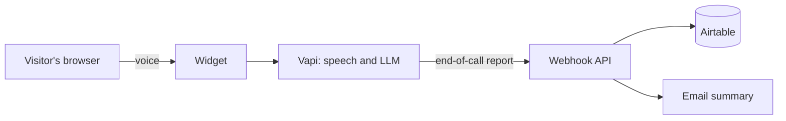

# Voice Sales Agent

**A voice AI agent for your website or online store. Visitors click a mic button and talk. It answers their questions, finds out what they need, and sends you the details. No forms, no phone tree.**

[**Try the live demo**](https://agent.qamaruldin.com) · [**Hire me on Upwork**](https://www.upwork.com/freelancers/qamaruldinhamzas) · [**LinkedIn**](https://www.linkedin.com/in/qamaruldinhamza/) · [**hire@qamaruldin.com**](mailto:hire@qamaruldin.com)

Built by [Qamar Ul Din Hamza](https://qamaruldin.com). Available as a custom build for your site or store.

> **Status:** in development. The demo goes live at the link above with the first release.

## What you get

| For your business                 | How the agent does it                                                               |
| --------------------------------- | ----------------------------------------------------------------------------------- |
| Fewer lost visitors               | Answers questions the moment they come up, on any page, at any hour                 |
| Leads you can act on              | Asks for name, need and contact details in conversation, then saves them            |
| Less time on repeat questions     | Answers from your own policies, catalogue and pricing, and hands off when it should |
| The whole conversation, not a tag | You get a summary and a full transcript of each call                                |
| Your brand, not mine              | Voice, wording, colours and the mic button are tuned to your site                   |

## See it working

The demo is my own sales assistant. Talk to it at [agent.qamaruldin.com](https://agent.qamaruldin.com). It:

- answers questions about my services, stack and background
- asks for your name, what you need and how to reach you
- shows my Upwork, LinkedIn and email links during and after the call
- saves the lead and the call transcript to my Airtable

The same widget is meant for my own sites: [qamaruldin.com](https://qamaruldin.com), [stackmesh.com](https://stackmesh.com) and [portal.qamaruldin.com](https://portal.qamaruldin.com), each with its own look and its own assistant.

## What I build for clients

The demo covers questions and lead capture. This section is what I build for clients, connected to their own systems.

### Online stores

For Shopify, WooCommerce, Next.js and React storefronts.

| Use                  | What the agent does                                                                                                            |
| -------------------- | ------------------------------------------------------------------------------------------------------------------------------ |
| Customer support     | Answers shipping, returns and product questions from your own policies and catalogue, and hands off to a person when it should |
| Sales                | Helps a shopper choose, answers objections, points them to the right product page or adds to cart                              |
| Order tracking       | Looks up an order by number and email and reads out the status and delivery date                                               |
| Voice product search | Turns "something waterproof for hiking under 150" into a catalogue search and talks through the results                        |

### Lawyers, advocates and attorneys

Law firms lose clients to unanswered calls and slow replies, especially after hours. A voice agent on the firm's website can take the first conversation:

- greet the visitor and find out the type of matter (family, immigration, criminal, property, business, injury and so on)
- capture name, contact details, location, urgency and a short description in the caller's own words
- note details needed for a conflict check, such as the other party's name
- screen for fit, for example practice area, jurisdiction and whether a deadline is close
- book a consultation on the firm's calendar, or flag the lead as urgent for a same-day callback
- send the intake summary to the right person by email, and write the lead to the firm's CRM or spreadsheet

Guardrails built into the design for this kind of work:

- It says it is an AI assistant at the start of the conversation.
- It does not give legal advice or predict outcomes, and says that a consultation with a lawyer is where advice happens.
- It states that talking to it does not create a lawyer-client relationship, and asks callers not to share sensitive details before they have spoken to the firm.
- Recording and transcript notices follow the firm's local rules. The wording is configured per firm.
- It hands off to a human for emergencies and for anything outside its scope.

Compliance depends on the firm's jurisdiction and bar rules. I build to the firm's requirements and do not claim blanket compliance.

### Other businesses with inbound leads

Agencies and consultancies, clinics and dental practices, real estate, home services, accountants, SaaS onboarding and demo booking. The pattern is the same: answer first, qualify, capture, notify, book.

### Connections I build

- CRMs and automation: HubSpot, GoHighLevel, Airtable, n8n, Make, Zapier
- Stores: Shopify, WooCommerce, BigCommerce
- Booking: Google Calendar, Cal.com, Calendly
- Email and messaging: Resend, SMTP, Slack
- Your own APIs and databases

## How a project runs

1. **Scope.** We agree what the agent should answer, what it should capture and where the details should go.
2. **Build.** I write the assistant, connect your systems and style the widget to your brand.
3. **Test.** We run real calls against your questions until the answers are right.
4. **Launch.** It goes live on your site, with spend limits and a domain allow-list set on your own Vapi account.

## Under the hood

- Speech recognition, the language model and the voice run on Vapi.
- When a call ends, Vapi sends a report to a webhook. The webhook checks a shared secret, validates the payload, and saves the lead and transcript.
- The call is capped in length, and the browser key only works on allowed domains.

Built with Next.js 16, React 19, TypeScript, Tailwind CSS 4, the Vapi Web SDK, Zod, Airtable and Resend, deployed on Vercel.

## Work with me

Want this for your business? Tell me what your site does and what you want the agent to handle.

- Upwork: [upwork.com/freelancers/qamaruldinhamzas](https://www.upwork.com/freelancers/qamaruldinhamzas)
- LinkedIn: [linkedin.com/in/qamaruldinhamza](https://www.linkedin.com/in/qamaruldinhamza/)
- Email: [hire@qamaruldin.com](mailto:hire@qamaruldin.com)
- Web: [qamaruldin.com](https://qamaruldin.com)
- Agency: [stackmesh.com](https://stackmesh.com)

## About this repository

This is a portfolio project, published so you can read how it is built. It is not a starter template, and the assistant configuration and deployment setup are not included.

The code is under an all-rights-reserved license, see [LICENSE](LICENSE).
