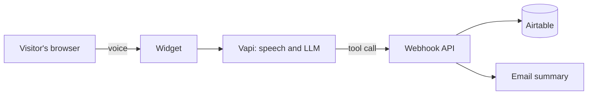

# Voice Sales Agent

A voice AI agent for websites and online stores. Visitors click a mic button and talk. The agent answers their questions, finds out what they need, and sends the details to the business. No forms, no phone tree.

**Live demo: [agent.qamaruldin.com](https://agent.qamaruldin.com)**

Built by [Qamar Ul Din Hamza](https://qamaruldin.com). Available as a custom build for your site or store.

> **Status:** in development. The demo goes live at the link above with the first release.

## What the demo does

The demo is my own sales assistant. It:

- answers questions about my services, stack and background
- asks the visitor for their name, what they need and how to reach them
- saves the lead to Airtable
- emails me a summary of the conversation

The same widget runs on my own sites: [qamaruldin.com](https://qamaruldin.com), [stackmesh.com](https://stackmesh.com) and [portal.qamaruldin.com](https://portal.qamaruldin.com), each with its own look and its own assistant.

## What it can be used for

The demo covers questions and lead capture. The rest of this section is what I build for clients, connected to their own systems.

### Online stores

For Shopify, WooCommerce, Next.js and React storefronts.

| Use                  | What the agent does                                                                                                            |
| -------------------- | ------------------------------------------------------------------------------------------------------------------------------ |
| Customer support     | Answers shipping, returns and product questions from your own policies and catalogue, and hands off to a person when it should |
| Sales                | Helps a shopper choose, answers objections, points them to the right product page or adds to cart                              |
| Order tracking       | Looks up an order by number and email and reads out the status and delivery date                                               |
| Voice product search | Turns "something waterproof for hiking under 150" into a catalogue search and talks through the results                        |

### Lawyers, advocates and attorneys

Law firms lose clients to unanswered calls and slow replies, especially after hours. A voice agent on the firm's website can take the first conversation:

- greet the visitor and find out the type of matter (family, immigration, criminal, property, business, injury and so on)
- capture name, contact details, location, urgency and a short description in the caller's own words
- note details needed for a conflict check, such as the other party's name
- screen for fit, for example practice area, jurisdiction and whether a deadline is close
- book a consultation on the firm's calendar, or flag the lead as urgent for a same-day callback
- send the intake summary to the right person by email, and write the lead to the firm's CRM or spreadsheet

Guardrails built into the design for this kind of work:

- It says it is an AI assistant at the start of the conversation.
- It does not give legal advice or predict outcomes, and says that a consultation with a lawyer is where advice happens.
- It states that talking to it does not create a lawyer-client relationship, and asks callers not to share sensitive details before they have spoken to the firm.
- Recording and transcript notices follow the firm's local rules. The wording is configured per firm.
- It hands off to a human for emergencies and for anything outside its scope.

Compliance depends on the firm's jurisdiction and bar rules. I build to the firm's requirements and do not claim blanket compliance.

### Other businesses with inbound leads

Agencies and consultancies, clinics and dental practices, real estate, home services, accountants, SaaS onboarding and demo booking. The pattern is the same: answer first, qualify, capture, notify, book.

### Connections I build

- CRMs and automation: HubSpot, GoHighLevel, Airtable, n8n, Make, Zapier
- Stores: Shopify, WooCommerce, BigCommerce
- Booking: Google Calendar, Cal.com, Calendly
- Email and messaging: Resend, SMTP, Slack
- Your own APIs and databases

## How it works

1. The widget is one script tag, so it also works on non-React sites like Astro and WordPress.
2. Speech recognition, the language model and the voice run on Vapi.
3. When the agent has what it needs, it calls a tool. The webhook validates the request, stores the lead and sends the email.
4. A shared secret and a domain allow-list protect the endpoint, and call length is capped.

## Stack

Next.js 16, React 19, TypeScript, Tailwind CSS 4, the Vapi Web SDK, Airtable, Resend, deployed on Vercel.

## About this repository

This is a portfolio project, published so you can read how it is built. It is not a starter template, and the assistant configuration and deployment setup are not included.

The code is under an all-rights-reserved license, see [LICENSE](LICENSE). If you want a voice agent for your own website or store, get in touch and I will build it for your brand and systems.

## Contact

- Email: [hire@qamaruldin.com](mailto:hire@qamaruldin.com)
- Web: [qamaruldin.com](https://qamaruldin.com)
- Agency: [stackmesh.com](https://stackmesh.com)
